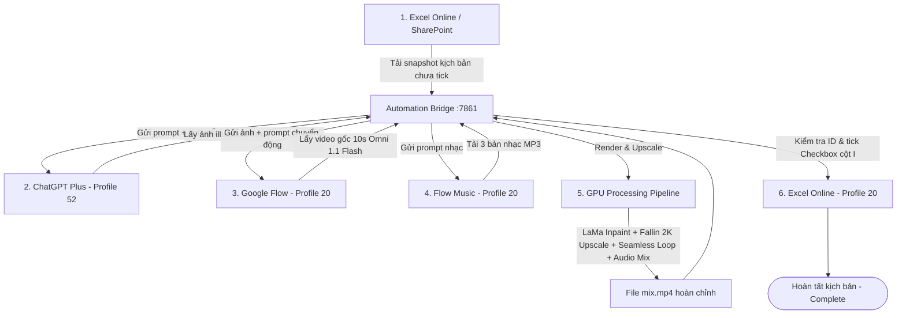

# Hướng Dẫn Sử Dụng Hệ Thống Tự Động Hóa LoFi Video Maker (End-to-End Automation Guide)

Tài liệu này giải thích chi tiết kiến trúc, quy trình vận hành và cách sử dụng hệ thống tự động hóa làm video LoFi từ kịch bản Excel đến video hoàn chỉnh.

---

## 1. Tổng quan Kiến trúc Hệ thống (Architecture Overview)

Hệ thống hoạt động theo mô hình **Agentic Local-Browser Pipeline**, kết hợp giữa GPU nội bộ và tự động hóa trình duyệt qua Chrome DevTools Protocol (CDP):



### Các thành phần chính:
1. **Automation Bridge (`automation_bridge.py`, Port 7861)**:
   - Máy chủ FastAPI quản lý hàng đợi tác vụ (`Engine`), lưu trữ trạng thái bền vững (`state.json`), phục vụ Web UI điều khiển và cung cấp API đồng bộ với Chrome Extension.
2. **LoFi Studio UI (`lofi_studio.py`, Port 7860)**:
   - Giao diện Gradio tích hợp kiểm soát GPU, khoanh vùng watermark và theo dõi tiến trình.
3. **Chrome Automation Extensions (`browser_extensions/lofi_automation`)**:
   - Sử dụng quyền `debugger` của Chrome để điều khiển tab ngầm độc lập qua CDP, gửi phím chuẩn (ControlA, Enter, Space) và tải asset mà không chiếm chuột/bàn phím của người dùng.
   - **Profile 20 (`main`)**: Phụ trách SharePoint Excel Online, Google Flow Video, và Flow Music.
   - **Profile 52 (`gpt`)**: Phụ trách ChatGPT Plus (Image Generation trong GPT Project).
4. **Bộ xử lý GPU (`studio_pipeline.py`, `video_preprocess.py`, `fallin_preprocess.py`)**:
   - Xóa watermark bằng LaMa inpainting.
   - Upscale 2K/4K qua Fallin AI ONNX / TensorRT.
   - Tạo vòng lặp video mượt mà (seamless looping).
   - Ghép playlist nhạc và blend 10% âm thanh môi trường gốc (source ambience).

---

## 2. Chi tiết Luồng Tự Động Hóa 6 Bước (The 6-Step Pipeline)

Mỗi chu trình tự động hóa sẽ hoàn thành trọn vẹn 1 kịch bản theo 6 bước:

### Bước 1: Đọc Snapshot Excel (`excel_snapshot`)
- Extension trên Profile 20 truy cập file Excel kịch bản trên SharePoint (ví dụ: `LoFi_100_Kich_Ban.xlsx`).
- Tải snapshot workbook về máy cục bộ.
- Đọc 3 sheet: `Kich_ban`, `Prompts`, `YouTube`.
- Tìm hàng đầu tiên có Checkbox ở cột `I` mang giá trị `FALSE` (chưa tick) và ID ở cột `A` (ví dụ `LOFI-001`, Hàng 8).

### Bước 2: Tạo ảnh minh họa ChatGPT (`generate_image`)
- Extension trên Profile 52 mở hội thoại trong ChatGPT Project đã cấu hình.
- Nạp các ảnh phong cách mẫu (`STYLE_MASTER.png`, `STYLE_APPROVED_*.png`) và gửi prompt mô tả cảnh.
- Tự động lọc bỏ các ảnh style tham chiếu, trích xuất đúng ảnh mới do AI tạo ra và tải về máy.

### Bước 3: Tạo video nền bằng Google Flow (`flow_video`)
- Extension trên profile main tự tạo Google Flow project mới cho mỗi kịch bản và lưu link để dùng lại khi tiếp tục sau lỗi.
- Tải ảnh đã tạo ở Bước 2 lên.
- Cấu hình chuẩn xác: **Omni 1.1 Flash**, **Video / Ingredients**, tỷ lệ **16:9**, độ phân giải **720p**, thời lượng **10 giây**, số lượng **x1**.
- Gửi prompt chuyển động vi mô (lá lay nhẹ, mái hiên dao động nhỏ...).
- Chờ render xong và tải video gốc (**Original size**) về máy.

### Bước 4: Tạo nhạc nền Flow Music (`flow_music`)
- Extension trên Profile 20 mở session Flow Music đã cấu hình.
- Đọc prompt âm nhạc từ kịch bản (BPM, thể loại jazz/lo-fi chords, nhạc cụ...).
- Lần lượt tạo và tải đủ số bài nhạc yêu cầu (mặc định 3 bài).
- Bộ chọn download được khoanh vùng chuẩn xác (`[role="menu"]`), tránh bấm nhầm nút tải video trên card.

### Bước 5: Xử lý video & Ghép nhạc trên GPU (`render`)
- Hệ thống chạy pipeline render trên máy:
  1. Áp mask watermark đã lưu và chạy model LaMa xóa mờ watermark.
  2. Fallin AI upscale khung hình lên độ phân giải 2K (1440p) hoặc 4K.
  3. Tạo video lặp liền mạch (seamless loop) với phase-aligned blend.
  4. Nối 3 track nhạc lo-fi thành playlist mượt mà với crossfade.
  5. Giữ 10% tiếng môi trường tự nhiên từ video gốc.
- Xuất toàn bộ thành phẩm vào thư mục cấu hình:
  `D:\download\LoFi_Exports\<ID>_<run_id>\`
  - `mix.mp4`: Video hoàn chỉnh (thời lượng ~8-10 phút).
  - `image.png`: Ảnh minh họa gốc.
  - `video.mp4`: Video Flow gốc.
  - `music/`: Các bài nhạc MP3 (01.mp3, 02.mp3, 03.mp3).
  - `youtube.json`: Tiêu đề, mô tả, tags, hashtags chuẩn bị đăng YouTube.

### Bước 6: Tick hoàn tất vào Excel Online (`excel_tick`)
- Extension trên Profile 20 mở lại workbook trên SharePoint.
- Chuyển sang sheet `Kich_ban`.
- Dùng Name Box nhảy đến ô ID cột A (`A8`), đối chiếu giá trị công thức khớp chính xác `LOFI-001` (ngăn chặn sửa nhầm dòng).
- Nhảy sang ô Checkbox cột I (`I8`).
- Kiểm tra trạng thái hiện tại là `FALSE`.
- Gửi phím `Space` qua CDP để bật Checkbox sang `TRUE`.
- Chờ thanh trạng thái của Excel hiển thị "Saved" / "All changes saved" lên đám mây.
- **Hoàn thành**: Trạng thái chuyển thẳng sang **`complete`** (Đã loại bỏ bước gửi duyệt Telegram trung gian).

---

## 3. Hướng Dẫn Cài Đặt Ban Đầu (One-Time Setup)

### Yêu cầu tiên quyết:
- Hệ điều hành: Windows 10/11 64-bit (hỗ trợ NVIDIA CUDA nếu muốn render GPU tốc độ cao).
- Python 3.10 hoặc 3.11 trong môi trường `.venv`.
- Trình duyệt Google Chrome với 2 Profile đã đăng nhập sẵn:
  - **Profile 20 (`main`)**: Đăng nhập tài khoản trường/công ty có quyền mở SharePoint Excel, tài khoản Google Flow, tài khoản Flow Music.
  - **Profile 52 (`gpt`)**: Đăng nhập tài khoản ChatGPT Plus có quyền vào Custom GPT Project.

### Bước 1: Nạp Extension vào 2 Profile Chrome
1. Khởi động bridge để sinh code cấu hình riêng cho từng profile:
   ```powershell
   .\.venv\Scripts\python.exe automation_bridge.py --port 7861
   ```
2. Trên Chrome **Profile 20 (`main`)**:
   - Vào `chrome://extensions`.
   - Bật **Developer mode** (Chế độ dành cho nhà phát triển).
   - Bấm **Load unpacked** (Tải tiện ích đã giải nén).
   - Chọn thư mục: `D:\lofi-video-maker\cache\automation\extensions\main`.
3. Trên Chrome **Profile 52 (`gpt`)**:
   - Vào `chrome://extensions`.
   - Bật **Developer mode**.
   - Bấm **Load unpacked**.
   - Chọn thư mục: `D:\lofi-video-maker\cache\automation\extensions\gpt`.

> [!NOTE]
> Chỉ cần nạp lần đầu. Khi code bridge thay đổi, bridge sẽ tự động cập nhật code và extension sẽ tự reload.

### Bước 2: Cấu hình thông số trên Web UI
1. Mở giao diện điều khiển tại: `http://127.0.0.1:7861` (hoặc tab **Tự động hóa** trên `http://127.0.0.1:7860`).
2. Kiểm tra các trường cấu hình:
   - **Excel workbook URL**: Link SharePoint chia sẻ file `LoFi_100_Kich_Ban.xlsx`.
   - **Google Flow**: Tự tạo project mới cho mỗi kịch bản bằng profile main đã chọn.
   - **ChatGPT Project URL**: Link Custom GPT Project tạo ảnh LoFi.
   - **Flow Music Session URL**: Link phiên làm việc Flow Music.
   - **Thư mục xuất (Output dir)**: `D:/download/LoFi_Exports` (hoặc thư mục tùy chọn).
   - **Số bài nhạc (Music count)**: `3` (hoặc số bài bạn muốn ghép).
   - **Thiết bị (Device)**: `cuda` (hoặc `cpu`).
3. Bấm **Lưu cấu hình**.

---

## 4. Hướng Dẫn Vận Hành Hàng Ngày (Daily Run)

### Cách 1: Chạy toàn bộ hệ thống qua Gradio Studio
```powershell
.\.venv\Scripts\python.exe lofi_studio.py --device cuda
```
- Mở `http://127.0.0.1:7860`, vào tab **Tự động hóa**.
- Bấm **Chạy một kịch bản**.
- Hệ thống sẽ tự động thực hiện từ Bước 1 đến Bước 6 và báo hoàn tất.

### Cách 2: Chạy Automation Bridge độc lập (Nhẹ, không cần Gradio)
```powershell
.\.venv\Scripts\python.exe automation_bridge.py --port 7861
```
- Mở `http://127.0.0.1:7861`.
- Quan sát đèn báo kết nối: cả 2 profile `main` và `gpt` đều hiển thị màu xanh lá (`online`).
- Bấm **Chạy một kịch bản**.
- Theo dõi thanh tiến trình 6 bước trực tiếp trên màn hình:
  - *Bước 1: Đọc Excel*
  - *Bước 2: Tạo ảnh cho Flow*
  - *Bước 3: Tạo video*
  - *Bước 4: Tạo nhạc (1/3, 2/3, 3/3)*
  - *Bước 5: Xử lý bản mix*
  - *Bước 6: Tick Excel (Hoàn tất)*

---

## 5. Xử Lý Sự Cố & Khôi Phục (Troubleshooting & Recovery)

### 1. Nếu tiến trình bị dừng hoặc mạng gián đoạn
- Bấm nút **Tiếp tục bước đang dừng** trên UI `http://127.0.0.1:7861`.
- Hệ thống có cơ chế kiểm tra an toàn:
  - Nếu ảnh hoặc video đã render xong, hệ thống tái sử dụng asset trên đĩa, không bao giờ gửi lại prompt để tránh tốn credit.
  - Nếu đang ở bước Excel, hệ thống thử kết nối lại và tick lại an toàn.

### 2. Tìm file video hoàn thành ở đâu?
- Toàn bộ video hoàn chỉnh được lưu tại:
  `D:\download\LoFi_Exports\<ID>_<RUN_ID>\mix.mp4`
- Video có độ phân giải 2560x1440 (2K QHD), 24fps, âm thanh nổi 320kbps với 3 bài nhạc nối liền mạch và 10% âm thanh môi trường.

### 3. Lưu ý quan trọng khi chạy:
- Giữ các cửa sổ Google Chrome luôn mở (không cần để ở foreground, extension tự điều khiển tab nền).
- Không tự ý tắt hoặc đóng tab đang được bot điều khiển (tab có thanh thông báo vàng của Chrome Debugger).
